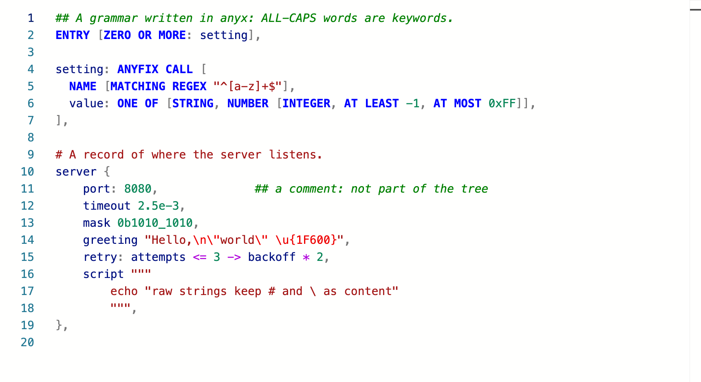
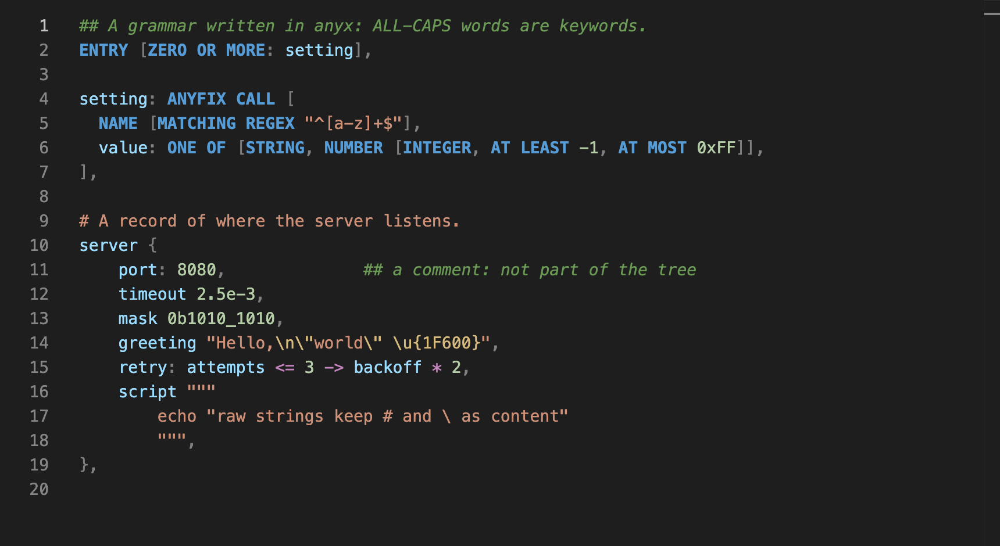

# Monaco syntax highlighting

[`anyx-monaco.ts`](anyx-monaco.ts) highlights anyx documents in the
[Monaco editor](https://microsoft.github.io/monaco-editor/). Copy the file into
your app, then register it once before creating an editor:

```ts
import * as monaco from 'monaco-editor'
import { registerAnyx } from './anyx-monaco'

registerAnyx(monaco, { languageId: 'anyx', extensions: ['.anyx'] })
monaco.editor.create(element, { value, language: 'anyx', theme: 'anyx-light' })
```

`languageId` can be your format's own name, such as `'poentaro'`. With
`@monaco-editor/react`, call `registerAnyx` in the editor's `beforeMount`.

The highlighting is the same for every anyx document, whatever its grammar.
Seven classes of text get their own color:

| Class | Monaco token | Examples |
|---|---|---|
| Keyword: a name word in all caps | `keyword` | `IF`, `ENTRY`, `X1` |
| Symbol word | `operator` | `+`, `<=`, `->` |
| Any other name word | `identifier` | `port`, `If`, `_1` |
| Number | `number` | `42`, `-1.5`, `1_000`, `2.5e-3`, `0xFF` |
| String | `string` | `"…"`, `"""` raw strings, `#` line strings |
| Comment | `comment` | `## to the end of the line` |
| Punctuation | `delimiter` | `,` `:` `.` `( ) [ ] { }` |

`registerAnyx` defines the themes `anyx-light` and `anyx-dark`. To keep your
own theme instead, spread `anyxLightThemeRules` or `anyxDarkThemeRules` into
its `rules`.





## Keeping your copy current

The tokenizer mirrors the lexer (`crates/anyx/src/lexer.rs`) and the
[tokenization rules](../../README.md#tokenization-rules). When those change,
copy the file again.
